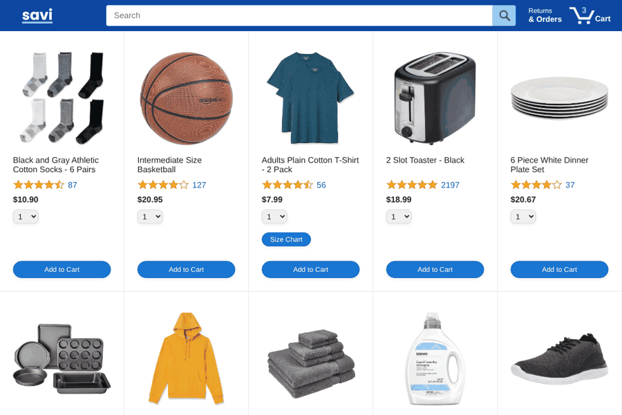

# 🛒 Savi Products

> An e-commerce web app built with vanilla JavaScript, HTML5, and CSS3. Browse a product catalog, manage a persistent shopping cart, choose delivery options, check out, and track orders.


---

## 🛍️ Features

* **Product Catalog:** Dynamic product grid with ratings, pricing, and keyword-based search.
* **Shopping Cart:** Add, remove, and update item quantities, persisted to `localStorage`.
* **Delivery Options:** Choose between multiple shipping speeds, each with its own cost and delivery window.
* **Checkout Flow:** Order summary and payment summary components for reviewing and placing an order.
* **Order Tracking:** View order history and track the delivery status of placed orders.
* **Specialized Product Types:** Clothing items link to a size chart; appliances include instructions & warranty links, via a `Product` → `Clothing` / `Appliance` class hierarchy.
* **Multiple Cart Implementations:** The same cart functionality built three ways to compare JS patterns — plain functions (`cart.js`), a closures/factory-function version (`cart-oop.js`), and an ES6 class with private fields (`cart-class.js`).

---

## 🚀 Demo & Screenshots

>   

---

## 🛠️ Installation & Setup

### Prerequisites
A modern web browser. A local server (e.g. the VS Code "Live Server" extension) is recommended so ES module imports work correctly.

### Steps

1. **Clone the repository:**
    ```bash
    git clone https://github.com/savindunethmika/savi_products.git
    ```

2. **Navigate to the project directory:**
    ```bash
    cd savi_products
    ```

3. **Run the app:**
    Open `index.html` with Live Server (or your browser).

4. **Backend:**
    Product data is served from `https://supersimplebackend.dev`, or you can run your own local backend using `backend/products.json`:
    ```bash
    npx json-server backend/products.json
    ```

---

## 📄 Pages

| Page | Description |
|---|---|
| `index.html` | Home page — product grid, search, add to cart |
| `checkout.html` | Cart review, delivery options, order placement |
| `orders.html` | Order history |
| `tracking.html` | Order tracking status |

---

## 📂 Project Structure

```
Savi_Products/
│
├── index.html            # Home page — product grid, search bar, cart icon
├── checkout.html          # Cart review, delivery options, order placement
├── orders.html            # Order history page
├── tracking.html          # Order tracking page
├── .gitignore
│
├── backend/
│   └── products.json      # Product dataset (id, name, price, rating, keywords, type, etc.)
│
├── data/
│   ├── products.js            # Product / Clothing / Appliance classes + fetch & XHR loaders
│   ├── cart.js                 # Cart logic — array + exported functions (localStorage-backed)
│   ├── cart-oop.js             # Same cart logic using a closure / factory-function pattern
│   ├── cart-class.js           # Same cart logic using an ES6 class with private fields
│   ├── deliveryOptions.js      # Delivery speed/price options + lookup helper
│   ├── orders.js               # Order history storage & retrieval
│   └── backend-practice.js     # Scratch file for practicing XHR requests
│
├── images/
│   ├── savi-logo.png / savi-logo-white.png
│   ├── savi-mobile-logo.png / savi-mobile-logo-white.png
│   ├── appliance-instructions.png
│   ├── appliance-warranty.png
│   ├── clothing-size-chart.png
│   ├── icons/              # UI icons (cart, search, checkout lock, hamburger menu, etc.)
│   ├── products/           # Product photos + variations/ (color/size alternates)
│   └── ratings/            # Star-rating images (rating-0.png … rating-50.png)
│
├── scripts/
│   ├── index.js           # Home page logic
│   ├── checkout.js         # Checkout page logic
│   ├── order.js            # Orders page logic
│   ├── tracking.js         # Tracking page logic
│   ├── checkout/
│   │   ├── checkoutHeader.js
│   │   ├── orderSummary.js
│   │   └── paymentSummary.js
│   └── utils/
│       └── money.js        # Currency formatting helper
│
├── styles/
│   ├── pages/
│   │   ├── index.css
│   │   ├── orders.css
│   │   ├── tracking.css
│   │   └── checkout/
│   │       ├── checkout.css
│   │       └── checkout-header.css
│   └── shared/
│       ├── savi-header.css
│       └── general.css
│
└── README.md
```

---

## 🧠 Key Concepts Practiced

| Concept | Where |
|---|---|
| ES6 classes & inheritance | `products.js` (`Product` → `Clothing`, `Appliance`) |
| Private class fields/methods | `cart-class.js` (`#localStorageKey`, `#loadFromStorage`) |
| Closures / factory functions | `cart-oop.js` |
| ES modules (`import`/`export`) | `cart.js`, `products.js`, `deliveryOptions.js`, `orders.js` |
| `localStorage` persistence | `cart.js`, `orders.js`, `cart-class.js`, `cart-oop.js` |
| Async data fetching (XHR vs. `fetch`) | `products.js`, `cart.js`, `backend-practice.js` |

---

## 🤝 Contributing
Contributions, bug reports, and feature requests are welcome!

* Fork the repository.
* Create your feature branch (`git checkout -b feature/NewFeature`).
* Commit your changes (`git commit -m 'Add NewFeature'`).
* Push to the branch (`git push origin feature/NewFeature`).
* Open a Pull Request.

---

## 📄 License

Distributed under the MIT License. See LICENSE for details.

> Copyright © Savindu Nethmika.
> All Rights Reserved.